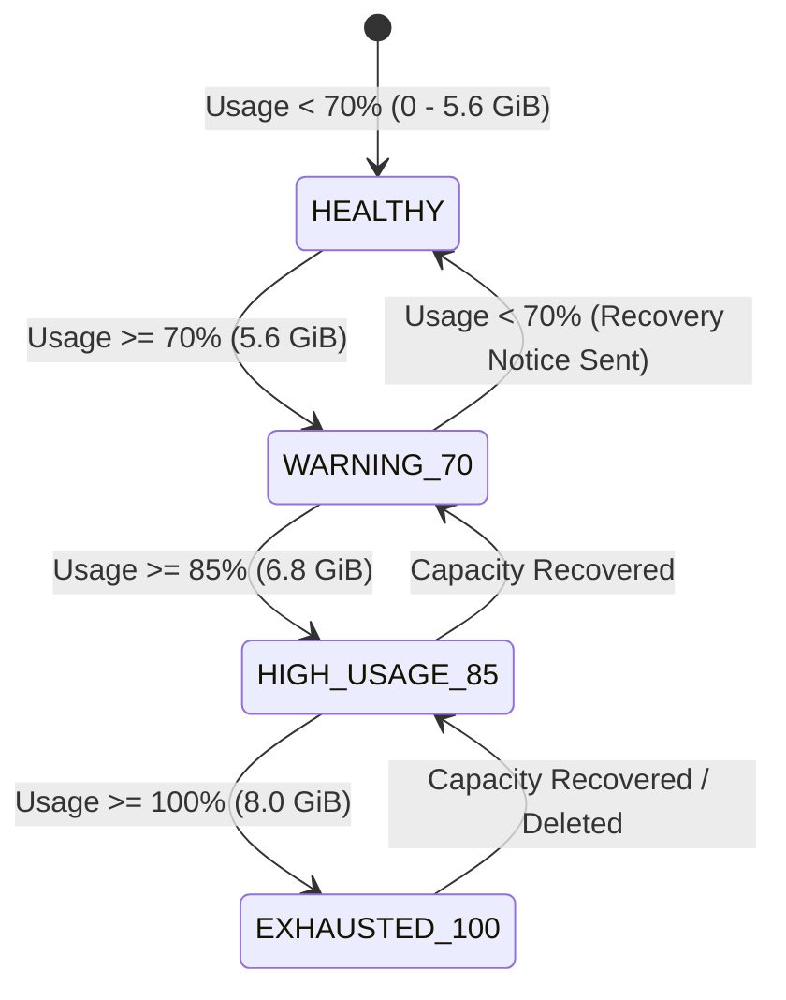

# Cost & Cloudflare Compliance Audit Report

**Audit Date:** November 15, 2026  
**Auditor:** Principal Infrastructure & Cloud Cost Architect  
**Subject:** Free-Tier-First Cost Optimization, Cloudflare R2 Multi-Account Rules, and Billing Protection

---

## 1. Cloudflare R2 Official Pricing & Free Allowance Verification

*Official Cloudflare R2 Documentation verified as of November 2026.*

| Component | Free Allowance (Monthly) | Paid Rate Beyond Free Tier | Notes |
|---|---|---|---|
| **Storage Capacity** | **10 GB** ($10,737,418,240 \text{ bytes}$) | **$0.015 per GB-month** | Charged prorated per byte-hour |
| **Class A Operations** | **1,000,000 requests** | **$4.50 per 1,000,000 requests** | PutObject, CopyObject, ListObjects, CreateMultipartUpload |
| **Class B Operations** | **10,000,000 requests** | **$0.36 per 1,000,000 requests** | GetObject, HeadObject, HeadBucket |
| **Data Egress (Bandwidth)** | **UNLIMITED / $0.00** | **$0.00 per GB** | **No egress fees** to the public internet or Cloudflare CDN |
| **Cloudflare Workers** | **100,000 requests / day** | **$5.00 / mo + $0.50/M** | Applicable if deploying edge router workers |

> [!IMPORTANT]
> The \$0.00 egress policy on Cloudflare R2 is the primary architectural driver for this platform. Serving 50 TB of high-definition video traffic per month costs \$0 in egress on Cloudflare R2, compared to approximately \$4,500 on AWS S3 (\$0.09/GB egress).

---

## 2. Multi-Account Compliance Strategy

1. **No Sybil or Billing Evasion**:
   - The platform strictly forbids automated account creation, fake identities, or billing circumvention.
   - Multiple Cloudflare accounts are utilized solely under legitimate organizational multi-tenant structures (e.g. separate business units, client-owned storage accounts, staging vs production isolation).
2. **Configurable Budgets**:
   - Every registered storage account includes a `monthly_budget_usd` parameter stored in PostgreSQL and configurable via the Admin Dashboard.
3. **Automated Safe Halting Policy**:
   - When an account's estimated charges approach its monthly budget, the allocation engine immediately sets its buckets to `EXHAUSTED_100`.
   - Halting prevents unexpected paid resource provisioning while keeping existing media accessible.

---

## 3. Storage Allocation Math & Unit Consistency

- **Unit Definition**: Binary units ($1 \text{ GiB} = 2^{30} = 1,073,741,824 \text{ bytes}$).
- **Logical Bucket Quota**:
  $$\text{Bucket Quota} = 8 \text{ GiB} = 8 \times 1,073,741,824 = 8,589,934,592 \text{ bytes}$$
- **Chunk Sizing**:
  $$\text{Chunk Size} = 256 \text{ MiB} = 256 \times 1,048,576 = 268,435,456 \text{ bytes}$$
- **Bucket Capacity**:
  $$\text{Chunks Per Bucket} = \frac{8,589,934,592}{268,435,456} = 32 \text{ chunks}$$

---

## 4. Threshold State Transition Verification

- **70% Threshold**: Admin alert triggered; deduplication suppresses repeated emails during periodic background checks.
- **85% Threshold**: High-usage alert triggered.
- **100% Threshold**: New allocations to bucket are stopped; future chunks automatically spill over into the next priority bucket.
- **Recovery Notification**: Sent when capacity falls back below 70%.
