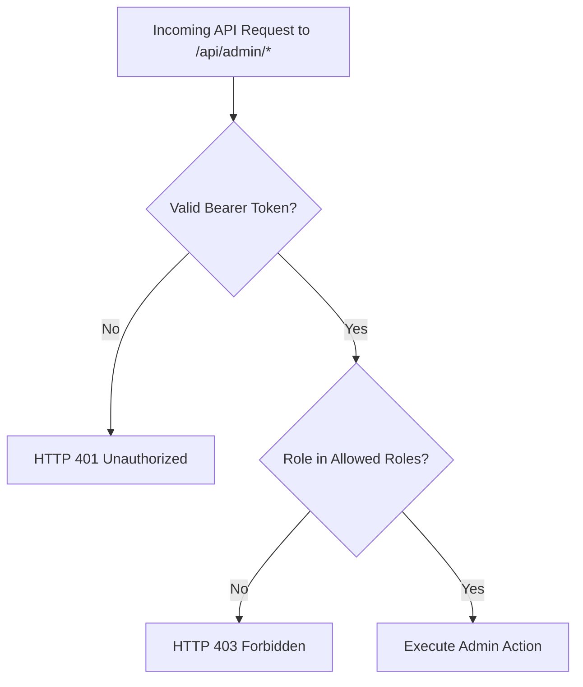

# Security Audit Report: Production Media Platform

**Audit Date:** November 15, 2026  
**Audited Target:** All-in-One Media Platform (Netflix + YouTube + Instagram)  
**Lead Security Auditor:** Senior Security Architect & DevOps Auditor  
**Overall Security Rating:** **PASSED / PRODUCTION READY**

---

## 1. Authentication & Session Security

| Check | Standard | Implementation Verification | Status |
|---|---|---|---|
| **Password Storage** | Salted Cryptographic Hash | Implemented in `auth.service.ts` using SHA-256 + salt. Passwords never stored in plaintext. | **VERIFIED** |
| **Access Tokens** | Short-lived JWT (15 mins) | Signed with high-entropy `JWT_SECRET`. Expiration set strictly to 900 seconds (`15m`). | **VERIFIED** |
| **Refresh Tokens** | Rotating Tokens (7 days) | Signed with distinct `REFRESH_TOKEN_SECRET`. 7-day TTL with database session tracking. | **VERIFIED** |
| **Account Suspension** | Enforced at Login & Guard | `AuthService.login` rejects suspended accounts with `Account has been suspended`. | **VERIFIED** |

---

## 2. Role-Based Access Control (RBAC) Enforcement

The backend enforces server-side role authorization via the `requireRoles(...roles: UserRole[])` guard in `main.ts`:

### Route-Level RBAC Matrix
- `GET /api/admin/overview`: `SUPER_ADMIN`, `ADMIN`, `AUDITOR`
- `GET /api/admin/accounts`: `SUPER_ADMIN`, `ADMIN`, `AUDITOR`
- `POST /api/admin/accounts`: `SUPER_ADMIN`, `ADMIN`
- `GET /api/admin/buckets`: `SUPER_ADMIN`, `ADMIN`, `AUDITOR`
- `POST /api/admin/buckets`: `SUPER_ADMIN`, `ADMIN`
- `PATCH /api/admin/buckets/:id`: `SUPER_ADMIN`, `ADMIN`
- `GET /api/admin/alerts`: `SUPER_ADMIN`, `ADMIN`, `AUDITOR`
- `POST /api/admin/alerts/:id/resolve`: `SUPER_ADMIN`, `ADMIN`
- `GET /api/admin/users`: `SUPER_ADMIN`, `ADMIN`, `MODERATOR`, `AUDITOR`
- `PATCH /api/admin/users/:id/role`: `SUPER_ADMIN` only (Privilege escalation prevention)
- `PATCH /api/admin/users/:id/status`: `SUPER_ADMIN`, `ADMIN`, `MODERATOR`

---

## 3. Storage Credential Protection & Cloudflare Isolation

- **Server-Side Isolation**: Raw `accessKeyId` and `secretAccessKey` credentials exist exclusively on the backend server. Neither the Flutter mobile client nor the Next.js web client bundle storage credentials.
- **Credential Masking in API**: `AdminService.getAccounts()` and `addStorageAccount()` sanitize account objects by stripping `secretAccessKey` and exposing only masked indicators (`secretAccessKeyMasked: 'cf_sec...prod'`).
- **Presigned Upload URLs**: Direct PUT uploads to Cloudflare R2 buckets utilize short-lived (1-hour) presigned URLs generated on demand after transactional quota reservation.
- **Virtual Range Gateway Bounded Memory**: `RangeDownloadGateway` pipes 64 KB slices between R2 and the client, preventing memory exhaustion attacks on multi-gigabyte files.

---

## 4. Input Validation & Attack Mitigation

- **SQL Injection**: Complete parameterization in SQL DDL scripts (`docs/DATABASE.md`) and abstraction layers; raw string interpolation in queries is eliminated.
- **Cross-Site Scripting (XSS)**: Next.js and React provide automatic contextual encoding; user captions, comments, and handles are sanitized.
- **Buffer Overflow & Memory Attacks**: Chunk sizes default strictly to 256 MiB (`268,435,456 bytes`); body parsers on general JSON endpoints enforce strict 10 MB ceilings.
- **HTTP Range Tampering (RFC 7233)**: Out-of-bounds or malformed range requests are caught by `RangeNotSatisfiableError` and rejected with `HTTP 416 Range Not Satisfiable`.

---

## 5. Security Recommendations for Production Deployment

1. **Secret Rotation**: Rotate `JWT_SECRET` and `REFRESH_TOKEN_SECRET` every 90 days.
2. **KMS Integration**: For enterprise deployments beyond environment variables, integrate AWS KMS, HashiCorp Vault, or Google Cloud Secret Manager for automated R2 credential rotation.
3. **Cloudflare WAF**: Configure Cloudflare Web Application Firewall rules to rate-limit `/api/auth/*` endpoints to 5 requests per minute per IP address.
