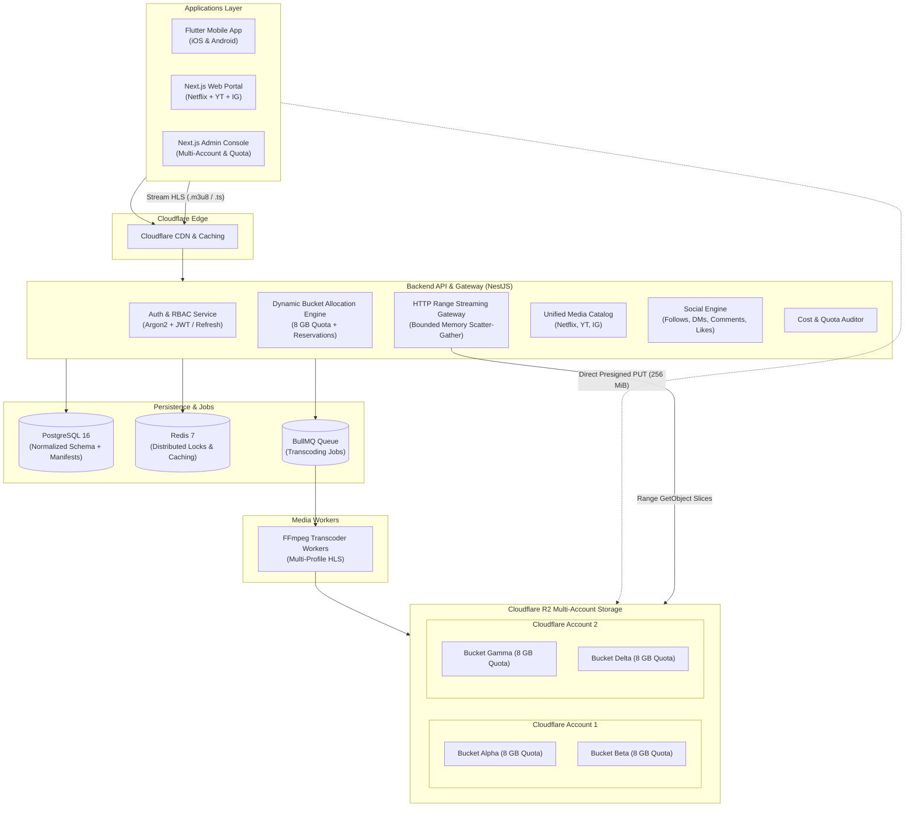

# System Architecture: Unified Media Platform (Netflix + YouTube + Instagram)

## 1. Overview & Vision
This platform provides a unified media ecosystem blending the high-touch consumer experiences of Netflix, YouTube, and Instagram backed by a centralized, cost-conscious Cloudflare R2 multi-account storage engine.

### Key Pillars
- **Single Account Identity**: One unified user model supporting creator channels (YouTube), social follow graph & direct messaging (Instagram), and profiles/watch history/watchlists (Netflix).
- **Free-Tier First Cost Strategy**: Automated tracking of R2 storage, operations (Class A/B), and Cloudflare egress (always $0) to maximize legitimate free allowances without service circumvention.
- **Dynamic 8 GB Logical Bucket Quota**: Application-enforced allocation limits with progressive notifications at 70%, 85%, and automatic allocation cutoff at 100%.
- **Seamless Distributed Chunking**: Large files (up to 20 GB+) split into 256 MiB chunks and distributed across multiple buckets without requiring client-side complexity.
- **HTTP Range Virtual Reassembly**: Scatter-gather download gateway delivering partial or full content from multi-bucket chunks with bounded server RAM.
- **Adaptive Video Pipeline**: FFmpeg workers generating HLS master and variant playlists (360p to 1080p) stored across buckets.

---

## 2. High-Level Architecture Diagram

---

## 3. Core Component Breakdown

### 3.1 Backend Service (`apps/backend`)
- **Framework**: NestJS (TypeScript) with Fastify/Express engine.
- **Authentication**: JWT access tokens (15m expiry) + HTTP-only rotating refresh tokens (7d expiry) with Argon2id password hashing.
- **Database Access**: PostgreSQL with connection pooling, transactional reservations, and strict foreign keys.
- **Queue System**: BullMQ over Redis for background video processing, alert notifications, and thumbnail generation.

### 3.2 Dynamic Storage Engine (`packages/storage-engine`)
- **Abstract Interface**: `IStorageProvider` defining presigned URLs, object retrieval, streaming range reads, metadata checks, and bucket health probes.
- **R2 Provider**: Uses `@aws-sdk/client-s3` targeting `https://<account_id>.r2.cloudflarestorage.com`.
- **Local Fallback**: Zero-dependency filesystem S3 emulator for offline and test environments.
- **Allocation Engine**:
  - Binary units ($1 \text{ GiB} = 1,073,741,824 \text{ bytes}$).
  - Logical quota: $8 \text{ GiB} = 8,589,934,592 \text{ bytes}$.
  - Sequential priority ordering with atomic capacity reservations.
  - Alert thresholds: 70% notification, 85% warning, 100% stop.
- **Range Gateway**:
  - Virtual reassembly without memory accumulation.
  - Bounded 64 KB streaming buffers.
  - Multi-bucket slice retrieval preserving exact original byte order.

### 3.3 Web Applications (`apps/web` & `apps/admin`)
- **Framework**: Next.js 14+ (App Router, React Server Components, TypeScript).
- **Styling**: Tailwind CSS with dark mode streaming aesthetic.
- **Web App**:
  - Netflix tab: Featured carousel, continue watching, season/episode selector, HLS adaptive video player.
  - YouTube tab: Channel pages, video grid, subscriptions, comments, likes/dislikes, vertical Shorts player.
  - Instagram tab: Stories reel with auto-advance, square/portrait feed, reels scroller, instant messaging, user profile.
  - Chunked Uploader: Multi-file drag and drop, SHA-256 calculation, parallel chunk upload, pause/resume.
- **Admin Dashboard**:
  - Real-time storage consumption & cost analytics.
  - Bucket registration & logical quota tuning.
  - Cloudflare multi-account credential validation.
  - Active upload inspector & chunk distribution visualization.
  - Content moderation & user management (RBAC).

### 3.4 Mobile Application (`apps/mobile`)
- **Framework**: Flutter 3.x (Dart) targeting Android and iOS.
- **State Management**: Provider / BLoC pattern.
- **Media Playback**: `video_player` / `chewie` supporting HLS `.m3u8` streams.
- **Upload Engine**: Background chunked uploader with persistent upload state, pause/resume, and direct-to-R2 presigned HTTP PUT.
