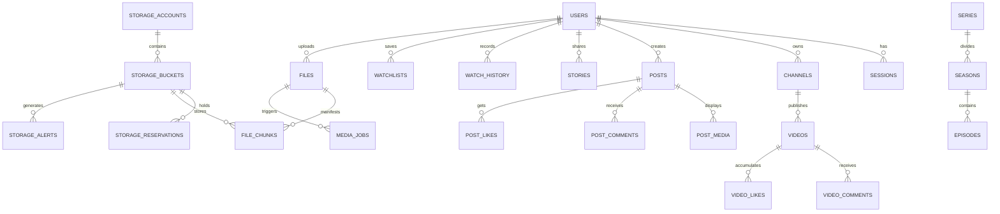

# Database Architecture & Schema Specification

## 1. Engine & Strategy
- **RDBMS**: PostgreSQL 16+
- **Integrity**: Strict foreign key constraints with `ON DELETE CASCADE` or `RESTRICT` where appropriate.
- **Concurrency**: `SELECT ... FOR UPDATE` row locks for bucket capacity reservations to eliminate race conditions in multi-threaded environments.
- **Units**: All byte metrics stored as `BIGINT` representing binary bytes ($1 \text{ GiB} = 1,073,741,824 \text{ bytes}$).

---

## 2. Entity-Relationship Diagram



---

## 3. Schema DDL Definitions

### 3.1 Identity & Access Control
```sql
CREATE TYPE user_role AS ENUM (
  'SUPER_ADMIN',
  'ADMIN',
  'MODERATOR',
  'SUPPORT',
  'AUDITOR',
  'USER',
  'CREATOR'
);

CREATE TYPE user_status AS ENUM (
  'ACTIVE',
  'SUSPENDED',
  'PENDING_VERIFICATION',
  'DEACTIVATED'
);

CREATE TABLE users (
  id UUID PRIMARY KEY DEFAULT gen_random_uuid(),
  email VARCHAR(255) UNIQUE NOT NULL,
  username VARCHAR(64) UNIQUE NOT NULL,
  password_hash VARCHAR(255) NOT NULL,
  display_name VARCHAR(128) NOT NULL,
  role user_role DEFAULT 'USER' NOT NULL,
  status user_status DEFAULT 'ACTIVE' NOT NULL,
  avatar_url TEXT,
  cover_image_url TEXT,
  bio TEXT,
  is_verified BOOLEAN DEFAULT FALSE,
  created_at TIMESTAMPTZ DEFAULT NOW(),
  updated_at TIMESTAMPTZ DEFAULT NOW()
);

CREATE INDEX idx_users_email ON users(email);
CREATE INDEX idx_users_username ON users(username);
CREATE INDEX idx_users_role ON users(role);

CREATE TABLE sessions (
  id UUID PRIMARY KEY DEFAULT gen_random_uuid(),
  user_id UUID NOT NULL REFERENCES users(id) ON DELETE CASCADE,
  refresh_token_hash VARCHAR(255) NOT NULL,
  ip_address VARCHAR(45),
  user_agent TEXT,
  expires_at TIMESTAMPTZ NOT NULL,
  created_at TIMESTAMPTZ DEFAULT NOW()
);

CREATE INDEX idx_sessions_user_id ON sessions(user_id);
```

### 3.2 Storage Infrastructure & Dynamic Allocation
```sql
CREATE TYPE storage_account_status AS ENUM (
  'ACTIVE',
  'DISABLED',
  'DEGRADED',
  'ERROR'
);

CREATE TYPE bucket_health_status AS ENUM (
  'HEALTHY',
  'WARNING_70',
  'HIGH_USAGE_85',
  'EXHAUSTED_100',
  'DISABLED',
  'ERROR'
);

CREATE TYPE alert_severity AS ENUM (
  'INFO',
  'WARNING_70',
  'CRITICAL_85',
  'EXHAUSTION_100',
  'RECOVERY'
);

CREATE TABLE storage_accounts (
  id UUID PRIMARY KEY DEFAULT gen_random_uuid(),
  display_name VARCHAR(128) NOT NULL,
  account_id VARCHAR(128) NOT NULL,
  endpoint VARCHAR(255) NOT NULL,
  access_key_id VARCHAR(128) NOT NULL,
  secret_access_key_encrypted TEXT NOT NULL,
  status storage_account_status DEFAULT 'ACTIVE' NOT NULL,
  monthly_budget_usd NUMERIC(10,2) DEFAULT 0.00,
  current_cost_usd NUMERIC(10,2) DEFAULT 0.00,
  last_health_check TIMESTAMPTZ,
  error_message TEXT,
  created_at TIMESTAMPTZ DEFAULT NOW(),
  updated_at TIMESTAMPTZ DEFAULT NOW()
);

CREATE TABLE storage_buckets (
  id UUID PRIMARY KEY DEFAULT gen_random_uuid(),
  bucket_name VARCHAR(128) NOT NULL,
  storage_account_id UUID NOT NULL REFERENCES storage_accounts(id) ON DELETE RESTRICT,
  region VARCHAR(64) DEFAULT 'auto',
  logical_quota_bytes BIGINT DEFAULT 8589934592 NOT NULL, -- 8 GiB
  used_storage_bytes BIGINT DEFAULT 0 NOT NULL,
  reserved_storage_bytes BIGINT DEFAULT 0 NOT NULL,
  priority INT DEFAULT 1 NOT NULL,
  health_status bucket_health_status DEFAULT 'HEALTHY' NOT NULL,
  is_enabled BOOLEAN DEFAULT TRUE NOT NULL,
  object_count BIGINT DEFAULT 0 NOT NULL,
  last_validated_at TIMESTAMPTZ,
  created_at TIMESTAMPTZ DEFAULT NOW(),
  updated_at TIMESTAMPTZ DEFAULT NOW(),
  CONSTRAINT uq_account_bucket UNIQUE (storage_account_id, bucket_name)
);

CREATE INDEX idx_storage_buckets_priority ON storage_buckets(priority, is_enabled);

CREATE TABLE storage_reservations (
  id VARCHAR(128) PRIMARY KEY,
  bucket_id UUID NOT NULL REFERENCES storage_buckets(id) ON DELETE CASCADE,
  file_id UUID NOT NULL,
  chunk_index INT NOT NULL,
  reserved_bytes BIGINT NOT NULL,
  is_committed BOOLEAN DEFAULT FALSE NOT NULL,
  expires_at TIMESTAMPTZ NOT NULL,
  created_at TIMESTAMPTZ DEFAULT NOW()
);

CREATE INDEX idx_reservations_bucket ON storage_reservations(bucket_id, is_committed);

CREATE TABLE storage_alerts (
  id UUID PRIMARY KEY DEFAULT gen_random_uuid(),
  bucket_id UUID REFERENCES storage_buckets(id) ON DELETE SET NULL,
  storage_account_id UUID REFERENCES storage_accounts(id) ON DELETE SET NULL,
  severity alert_severity NOT NULL,
  threshold_percent INT NOT NULL,
  message TEXT NOT NULL,
  used_bytes BIGINT NOT NULL,
  quota_bytes BIGINT NOT NULL,
  is_resolved BOOLEAN DEFAULT FALSE NOT NULL,
  resolved_at TIMESTAMPTZ,
  email_sent BOOLEAN DEFAULT FALSE NOT NULL,
  sent_at TIMESTAMPTZ,
  created_at TIMESTAMPTZ DEFAULT NOW()
);

CREATE INDEX idx_storage_alerts_bucket ON storage_alerts(bucket_id, severity, is_resolved);
```

### 3.3 Large-File Manifests & Chunks
```sql
CREATE TYPE file_upload_status AS ENUM (
  'PENDING',
  'UPLOADING',
  'VERIFYING',
  'READY',
  'FAILED',
  'ABORTED'
);

CREATE TYPE chunk_upload_status AS ENUM (
  'PENDING',
  'UPLOADED',
  'VERIFIED',
  'FAILED'
);

CREATE TABLE files (
  id UUID PRIMARY KEY DEFAULT gen_random_uuid(),
  owner_id UUID NOT NULL REFERENCES users(id) ON DELETE CASCADE,
  original_filename VARCHAR(255) NOT NULL,
  mime_type VARCHAR(128) NOT NULL,
  total_size_bytes BIGINT NOT NULL,
  total_sha256_checksum VARCHAR(64),
  chunk_count INT NOT NULL,
  chunk_size_bytes BIGINT DEFAULT 268435456 NOT NULL, -- 256 MiB
  upload_status file_upload_status DEFAULT 'PENDING' NOT NULL,
  is_distributed BOOLEAN DEFAULT FALSE NOT NULL,
  created_at TIMESTAMPTZ DEFAULT NOW(),
  updated_at TIMESTAMPTZ DEFAULT NOW()
);

CREATE INDEX idx_files_owner ON files(owner_id);
CREATE INDEX idx_files_status ON files(upload_status);

CREATE TABLE file_chunks (
  id VARCHAR(128) PRIMARY KEY,
  file_id UUID NOT NULL REFERENCES files(id) ON DELETE CASCADE,
  chunk_index INT NOT NULL,
  storage_account_id UUID NOT NULL REFERENCES storage_accounts(id) ON DELETE RESTRICT,
  bucket_id UUID NOT NULL REFERENCES storage_buckets(id) ON DELETE RESTRICT,
  bucket_name VARCHAR(128) NOT NULL,
  object_key TEXT NOT NULL,
  byte_start BIGINT NOT NULL,
  byte_end BIGINT NOT NULL,
  chunk_size_bytes BIGINT NOT NULL,
  chunk_sha256_checksum VARCHAR(64),
  status chunk_upload_status DEFAULT 'PENDING' NOT NULL,
  uploaded_at TIMESTAMPTZ,
  verified_at TIMESTAMPTZ,
  CONSTRAINT uq_file_chunk_index UNIQUE (file_id, chunk_index)
);

CREATE INDEX idx_file_chunks_file_order ON file_chunks(file_id, chunk_index ASC);
```

### 3.4 Media Processing & HLS Assets
```sql
CREATE TYPE media_job_status AS ENUM (
  'QUEUED',
  'PROCESSING',
  'COMPLETED',
  'FAILED'
);

CREATE TABLE media_jobs (
  id UUID PRIMARY KEY DEFAULT gen_random_uuid(),
  file_id UUID NOT NULL REFERENCES files(id) ON DELETE CASCADE,
  status media_job_status DEFAULT 'QUEUED' NOT NULL,
  progress_percent INT DEFAULT 0,
  error_message TEXT,
  profiles_generated JSONB DEFAULT '[]'::jsonb,
  master_playlist_url TEXT,
  thumbnail_url TEXT,
  duration_seconds NUMERIC(10,2),
  started_at TIMESTAMPTZ,
  completed_at TIMESTAMPTZ,
  created_at TIMESTAMPTZ DEFAULT NOW()
);
```

### 3.5 Netflix Catalog
```sql
CREATE TABLE genres (
  id UUID PRIMARY KEY DEFAULT gen_random_uuid(),
  name VARCHAR(64) UNIQUE NOT NULL,
  slug VARCHAR(64) UNIQUE NOT NULL
);

CREATE TABLE movies (
  id UUID PRIMARY KEY DEFAULT gen_random_uuid(),
  file_id UUID REFERENCES files(id) ON DELETE SET NULL,
  title VARCHAR(255) NOT NULL,
  description TEXT NOT NULL,
  release_year INT NOT NULL,
  duration_minutes INT NOT NULL,
  rating VARCHAR(16) DEFAULT 'PG-13',
  backdrop_url TEXT NOT NULL,
  poster_url TEXT NOT NULL,
  trailer_url TEXT,
  master_playlist_url TEXT NOT NULL,
  audio_tracks JSONB DEFAULT '[]'::jsonb,
  subtitles JSONB DEFAULT '[]'::jsonb,
  is_featured BOOLEAN DEFAULT FALSE,
  is_trending BOOLEAN DEFAULT FALSE,
  views_count BIGINT DEFAULT 0,
  created_at TIMESTAMPTZ DEFAULT NOW()
);

CREATE TABLE movie_genres (
  movie_id UUID REFERENCES movies(id) ON DELETE CASCADE,
  genre_id UUID REFERENCES genres(id) ON DELETE CASCADE,
  PRIMARY KEY (movie_id, genre_id)
);

CREATE TABLE series (
  id UUID PRIMARY KEY DEFAULT gen_random_uuid(),
  title VARCHAR(255) NOT NULL,
  description TEXT NOT NULL,
  release_year INT NOT NULL,
  rating VARCHAR(16) DEFAULT 'TV-MA',
  backdrop_url TEXT NOT NULL,
  poster_url TEXT NOT NULL,
  trailer_url TEXT,
  seasons_count INT DEFAULT 1,
  is_featured BOOLEAN DEFAULT FALSE,
  is_trending BOOLEAN DEFAULT FALSE,
  created_at TIMESTAMPTZ DEFAULT NOW()
);

CREATE TABLE seasons (
  id UUID PRIMARY KEY DEFAULT gen_random_uuid(),
  series_id UUID NOT NULL REFERENCES series(id) ON DELETE CASCADE,
  season_number INT NOT NULL,
  title VARCHAR(128) NOT NULL,
  overview TEXT,
  poster_url TEXT,
  CONSTRAINT uq_series_season UNIQUE (series_id, season_number)
);

CREATE TABLE episodes (
  id UUID PRIMARY KEY DEFAULT gen_random_uuid(),
  season_id UUID NOT NULL REFERENCES seasons(id) ON DELETE CASCADE,
  file_id UUID REFERENCES files(id) ON DELETE SET NULL,
  episode_number INT NOT NULL,
  title VARCHAR(255) NOT NULL,
  overview TEXT,
  duration_minutes INT NOT NULL,
  still_url TEXT NOT NULL,
  master_playlist_url TEXT NOT NULL,
  audio_tracks JSONB DEFAULT '[]'::jsonb,
  subtitles JSONB DEFAULT '[]'::jsonb,
  CONSTRAINT uq_season_episode UNIQUE (season_id, episode_number)
);

CREATE TABLE watch_history (
  id UUID PRIMARY KEY DEFAULT gen_random_uuid(),
  user_id UUID NOT NULL REFERENCES users(id) ON DELETE CASCADE,
  movie_id UUID REFERENCES movies(id) ON DELETE CASCADE,
  episode_id UUID REFERENCES episodes(id) ON DELETE CASCADE,
  progress_seconds INT DEFAULT 0 NOT NULL,
  total_duration_seconds INT NOT NULL,
  is_completed BOOLEAN DEFAULT FALSE,
  last_watched_at TIMESTAMPTZ DEFAULT NOW(),
  CONSTRAINT chk_target_media CHECK (
    (movie_id IS NOT NULL AND episode_id IS NULL) OR
    (movie_id IS NULL AND episode_id IS NOT NULL)
  )
);

CREATE TABLE watchlists (
  id UUID PRIMARY KEY DEFAULT gen_random_uuid(),
  user_id UUID NOT NULL REFERENCES users(id) ON DELETE CASCADE,
  movie_id UUID REFERENCES movies(id) ON DELETE CASCADE,
  series_id UUID REFERENCES series(id) ON DELETE CASCADE,
  added_at TIMESTAMPTZ DEFAULT NOW(),
  CONSTRAINT uq_user_watchlist_item UNIQUE (user_id, movie_id, series_id)
);
```

### 3.6 YouTube Engine
```sql
CREATE TABLE channels (
  id UUID PRIMARY KEY DEFAULT gen_random_uuid(),
  user_id UUID UNIQUE NOT NULL REFERENCES users(id) ON DELETE CASCADE,
  handle VARCHAR(64) UNIQUE NOT NULL,
  title VARCHAR(128) NOT NULL,
  description TEXT,
  avatar_url TEXT NOT NULL,
  banner_url TEXT,
  subscriber_count BIGINT DEFAULT 0,
  video_count BIGINT DEFAULT 0,
  total_views BIGINT DEFAULT 0,
  created_at TIMESTAMPTZ DEFAULT NOW()
);

CREATE TABLE videos (
  id UUID PRIMARY KEY DEFAULT gen_random_uuid(),
  channel_id UUID NOT NULL REFERENCES channels(id) ON DELETE CASCADE,
  file_id UUID REFERENCES files(id) ON DELETE SET NULL,
  title VARCHAR(255) NOT NULL,
  description TEXT,
  thumbnail_url TEXT NOT NULL,
  master_playlist_url TEXT NOT NULL,
  duration_seconds INT DEFAULT 0,
  views_count BIGINT DEFAULT 0,
  likes_count BIGINT DEFAULT 0,
  dislikes_count BIGINT DEFAULT 0,
  comment_count BIGINT DEFAULT 0,
  is_short BOOLEAN DEFAULT FALSE,
  visibility VARCHAR(16) DEFAULT 'PUBLIC',
  tags TEXT[] DEFAULT ARRAY[]::TEXT[],
  created_at TIMESTAMPTZ DEFAULT NOW()
);

CREATE INDEX idx_videos_channel ON videos(channel_id);
CREATE INDEX idx_videos_is_short ON videos(is_short);

CREATE TABLE subscriptions (
  id UUID PRIMARY KEY DEFAULT gen_random_uuid(),
  user_id UUID NOT NULL REFERENCES users(id) ON DELETE CASCADE,
  channel_id UUID NOT NULL REFERENCES channels(id) ON DELETE CASCADE,
  created_at TIMESTAMPTZ DEFAULT NOW(),
  CONSTRAINT uq_user_channel_sub UNIQUE (user_id, channel_id)
);

CREATE TABLE video_comments (
  id UUID PRIMARY KEY DEFAULT gen_random_uuid(),
  video_id UUID NOT NULL REFERENCES videos(id) ON DELETE CASCADE,
  user_id UUID NOT NULL REFERENCES users(id) ON DELETE CASCADE,
  parent_id UUID REFERENCES video_comments(id) ON DELETE CASCADE,
  content TEXT NOT NULL,
  likes_count INT DEFAULT 0,
  created_at TIMESTAMPTZ DEFAULT NOW()
);
```

### 3.7 Instagram Engine
```sql
CREATE TABLE posts (
  id UUID PRIMARY KEY DEFAULT gen_random_uuid(),
  user_id UUID NOT NULL REFERENCES users(id) ON DELETE CASCADE,
  caption TEXT,
  location VARCHAR(128),
  likes_count INT DEFAULT 0,
  comments_count INT DEFAULT 0,
  is_reel BOOLEAN DEFAULT FALSE,
  created_at TIMESTAMPTZ DEFAULT NOW()
);

CREATE TABLE post_media (
  id UUID PRIMARY KEY DEFAULT gen_random_uuid(),
  post_id UUID NOT NULL REFERENCES posts(id) ON DELETE CASCADE,
  file_id UUID REFERENCES files(id) ON DELETE SET NULL,
  media_type VARCHAR(16) NOT NULL, -- 'IMAGE', 'VIDEO'
  url TEXT NOT NULL,
  thumbnail_url TEXT,
  aspect_ratio NUMERIC(5,2) DEFAULT 1.0,
  order_index INT DEFAULT 0
);

CREATE TABLE stories (
  id UUID PRIMARY KEY DEFAULT gen_random_uuid(),
  user_id UUID NOT NULL REFERENCES users(id) ON DELETE CASCADE,
  file_id UUID REFERENCES files(id) ON DELETE SET NULL,
  media_url TEXT NOT NULL,
  media_type VARCHAR(16) NOT NULL,
  duration_seconds INT DEFAULT 15,
  expires_at TIMESTAMPTZ NOT NULL,
  created_at TIMESTAMPTZ DEFAULT NOW()
);

CREATE INDEX idx_stories_active ON stories(user_id, expires_at);

CREATE TABLE follows (
  id UUID PRIMARY KEY DEFAULT gen_random_uuid(),
  follower_id UUID NOT NULL REFERENCES users(id) ON DELETE CASCADE,
  following_id UUID NOT NULL REFERENCES users(id) ON DELETE CASCADE,
  created_at TIMESTAMPTZ DEFAULT NOW(),
  CONSTRAINT uq_follow_pair UNIQUE (follower_id, following_id)
);

CREATE TABLE direct_conversations (
  id UUID PRIMARY KEY DEFAULT gen_random_uuid(),
  participant1_id UUID NOT NULL REFERENCES users(id) ON DELETE CASCADE,
  participant2_id UUID NOT NULL REFERENCES users(id) ON DELETE CASCADE,
  updated_at TIMESTAMPTZ DEFAULT NOW(),
  CONSTRAINT uq_participants UNIQUE (participant1_id, participant2_id)
);

CREATE TABLE direct_messages (
  id UUID PRIMARY KEY DEFAULT gen_random_uuid(),
  conversation_id UUID NOT NULL REFERENCES direct_conversations(id) ON DELETE CASCADE,
  sender_id UUID NOT NULL REFERENCES users(id) ON DELETE CASCADE,
  recipient_id UUID NOT NULL REFERENCES users(id) ON DELETE CASCADE,
  content TEXT NOT NULL,
  media_url TEXT,
  is_read BOOLEAN DEFAULT FALSE,
  created_at TIMESTAMPTZ DEFAULT NOW()
);
```
