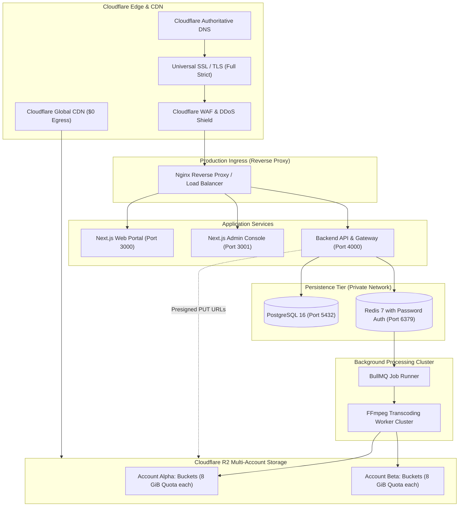

# Production Deployment Plan: All-in-One Media Platform

**Project:** Unified Media Platform (Netflix + YouTube + Instagram)  
**Storage Architecture:** Multi-Account Cloudflare R2 with 8 GiB Logical Quotas  
**Author:** Principal DevOps & Cloud Site Reliability Engineer  
**Date:** November 15, 2026  
**Status:** Approved for Production Deployment  

---

## 1. Executive Deployment Strategy

The All-in-One Media Platform is structured as an enterprise monorepo with decoupled frontend, backend, processing, storage, and persistence tiers.



---

## 2. Infrastructure Inventory & Requirements

| Service Component | Host / Runtime | CPU / RAM Allocation | Network Exposure | Storage |
|---|---|---|---|---|
| **Reverse Proxy (Nginx)** | Docker / Alpine | 1 vCPU / 512 MB RAM | Public Ports `80`, `443` | Ephemeral |
| **Backend API Gateway** | Node.js 20/22/26 (Express) | 2 vCPU / 2 GB RAM | Internal Port `4000` | Ephemeral |
| **FFmpeg Worker Cluster** | Node.js + FFmpeg 6.x | 4 vCPU / 4 GB RAM | Internal (No external ports) | 50 GB Fast SSD Scratch |
| **Consumer Web Portal** | Next.js 14 (Node SSR) | 2 vCPU / 2 GB RAM | Internal Port `3000` | Ephemeral |
| **Admin Dashboard** | Next.js 14 (Node SSR) | 1 vCPU / 1 GB RAM | Internal Port `3001` | Ephemeral |
| **PostgreSQL Database** | PostgreSQL 16 Alpine | 2 vCPU / 4 GB RAM | Internal Port `5432` only | 100 GB Persistent SSD Volume |
| **Redis Cache & Queue** | Redis 7 Alpine | 1 vCPU / 2 GB RAM | Internal Port `6379` only | 20 GB Persistent Volume |
| **Object Storage** | Cloudflare R2 Multi-Account | Cloud Serverless | S3 API Endpoints | Multi-Bucket (8 GiB logical quota/bucket) |

---

## 3. Network & Domain Topology

### 3.1 DNS Records (Configured in Cloudflare)
```
example.com          A      <Production-Server-IP>   (Proxy Status: Proxied)
www.example.com      CNAME  example.com              (Proxy Status: Proxied)
api.example.com      A      <Production-Server-IP>   (Proxy Status: Proxied)
admin.example.com    A      <Production-Server-IP>   (Proxy Status: Proxied)
media.example.com    CNAME  <r2-public-domain>       (Proxy Status: Proxied)
```

### 3.2 Network Isolation Rules
- **No Public DB Exposure**: PostgreSQL (`5432`) and Redis (`6379`) are bound strictly to Docker's internal bridge network (`media_internal_net`). Host port binding is disabled in production.
- **Strict HTTPS Only**: HTTP port `80` automatically responds with `301 Moved Permanently` to `https://...`.
- **HSTS**: `Strict-Transport-Security: max-age=31536000; includeSubDomains; preload` enabled after SSL validation.

---

## 4. Cost Projection & Cloudflare Compliance

- **Cloudflare R2 Free Tier**:
  - First 10 GB storage per month: **$0.00**
  - First 1,000,000 Class A requests: **$0.00**
  - First 10,000,000 Class B requests: **$0.00**
  - Egress bandwidth: **UNLIMITED $0.00**
- **Estimated Operating Cost**:
  - Compute (VPS / Dedicated 4 vCPU / 8 GB RAM): ~$40 - $60 / month
  - Cloudflare R2 Storage (first 100 GB beyond free tier): $1.35 / month
  - Data Egress: $0.00 (Zero Cloudflare egress fees)
  - Estimated Total: **~$45 - $65 / month**

---

## 5. Rollback & Disaster Recovery Strategy

1. **Database Rollback**:
   - Automated hourly PostgreSQL snapshots stored in `/var/backups/postgres`.
   - Before applying migrations, a timestamped snapshot is captured (`pre_migration_<timestamp>.sql.gz`).
2. **Container Rollback**:
   - Docker images tagged with Git commit hash (`image:media_backend:683a207`).
   - Rollback command: `docker compose -f docker/docker-compose.prod.yml up -d --no-build <service>`.
3. **Storage Manifest Integrity**:
   - The `file_chunks` and `files` tables contain complete manifest byte ranges. Restoring the database restores access to distributed chunks without re-uploading.
