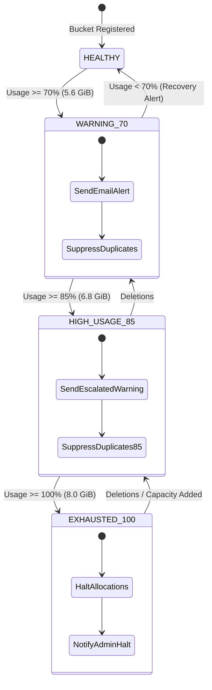

# Storage Architecture: Cloudflare R2 Multi-Account Engine

## 1. Compliance & Ethical Multi-Account Strategy
This system implements multi-account Cloudflare R2 integration strictly complying with Cloudflare's Terms of Service and API usage guidelines:
- **No Sybil/Fake Accounts**: All connected accounts must be legitimate, authorized accounts with verified ownership and payment methods where applicable.
- **Configurable Limits**: No hardcoded assumptions about free allowances. Limits and logical quotas are configurable through the Admin Dashboard.
- **Transparent Cost Projection**: Continuous tracking of stored bytes, Class A operations ($4.50/M), Class B operations ($0.36/M), and bandwidth ($0 egress on R2).
- **Graceful Degradation**: When a budget or logical threshold is met, the system prevents silent unexpected charges by halting allocation and alerting operations.

---

## 2. Dynamic Bucket Allocation Engine

### 2.1 The 8 GB Logical Quota
To ensure predictable storage boundaries, load balancing across accounts, and fine-grained disaster isolation, each registered bucket is assigned an application-level logical quota:
$$\text{Logical Quota} = 8 \text{ GiB} = 8 \times 1,024^3 = 8,589,934,592 \text{ bytes}$$

> [!IMPORTANT]
> The 8 GB quota is an application-enforced allocation ceiling, not a claim that Cloudflare R2 natively limits buckets to 8 GB. This quota is completely configurable via the Admin Dashboard.

### 2.2 Threshold State Machine & Alert Deduplication


### 2.3 Sequential Allocation Lifecycle
1. **Query**: The allocation engine retrieves all enabled buckets sorted by `priority ASC, id ASC`.
2. **Atomic Lock & Reserve**:
   $$\text{Remaining Capacity} = \text{Logical Quota} - (\text{Used Bytes} + \text{Reserved Bytes})$$
   If $\text{Remaining Capacity} \ge \text{Chunk Size}$, a transactional reservation is created:
   ```sql
   INSERT INTO storage_reservations (id, bucket_id, file_id, chunk_index, reserved_bytes, expires_at)
   VALUES ($1, $2, $3, $4, $5, NOW() + INTERVAL '1 hour');
   ```
3. **Commit or Rollback**:
   - On verified chunk upload: `used_storage_bytes += chunk_size`, `reserved_storage_bytes -= chunk_size`.
   - On failure or timeout: `reserved_storage_bytes -= chunk_size`, reservation is cancelled.
4. **Spillover**: If the current bucket does not have enough capacity, the engine seamlessly tests the next bucket in sequence. If all buckets are exhausted, allocation halts cleanly and an alert is recorded.

---

## 3. Dynamic Registration & Zero-Client-Update Architecture
- Mobile (Flutter) and Web clients **never** connect directly to fixed bucket endpoints.
- Clients communicate solely with the backend API to initiate an upload session.
- The backend evaluates the currently available buckets and returns presigned S3 URLs pointing directly to the target R2 bucket and key.
- Adding a new Cloudflare account or bucket in the Admin Dashboard is instantly reflected in the next upload allocation session without modifying or redeploying any mobile or web app.

---

## 4. Encryption & Secret Management
- Cloudflare R2 Secret Access Keys are encrypted at rest using AES-256-GCM before persisting in PostgreSQL.
- S3 credentials and raw signatures are never exposed to browser consoles, client logs, or public APIs.
