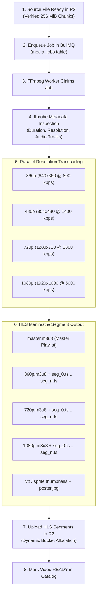

# Video Streaming Architecture: FFmpeg Worker Pipeline & Adaptive HLS

## 1. Architectural Strategy
To deliver a video streaming experience akin to Netflix and YouTube on mobile and web devices across erratic network conditions, the platform uses **HTTP Live Streaming (HLS)** with multi-bitrate adaptive bitrate streaming (ABR).

Original source files are never served directly as flat MP4s for streaming. Instead:
1. Videos undergo background transcoding into fragmented `.ts` video segments (typically 4 or 6 seconds).
2. Segment files and manifest playlists (`.m3u8`) are stored across configured Cloudflare R2 buckets.
3. Edge delivery leverages Cloudflare CDN caching for near-zero startup buffering.
4. Clients dynamically adjust video quality (360p, 480p, 720p, 1080p) according to network throughput.

---

## 2. HLS Transcoding Pipeline



---

## 3. Profiles & Encoding Specifications

| Profile | Resolution | Target Video Bitrate | Target Audio Bitrate | Segment Length | Frame Rate |
|---|---|---|---|---|---|
| **360p** | $640 \times 360$ | $800 \text{ kbps}$ | $96 \text{ kbps}$ (AAC) | $4 \text{ seconds}$ | 30 fps |
| **480p** | $854 \times 480$ | $1,400 \text{ kbps}$ | $128 \text{ kbps}$ (AAC) | $4 \text{ seconds}$ | 30 fps |
| **720p (HD)** | $1280 \times 720$ | $2,800 \text{ kbps}$ | $160 \text{ kbps}$ (AAC) | $4 \text{ seconds}$ | 30/60 fps |
| **1080p (FHD)**| $1920 \times 1080$ | $5,000 \text{ kbps}$ | $192 \text{ kbps}$ (AAC) | $4 \text{ seconds}$ | 30/60 fps |

### Example Master Playlist (`master.m3u8`)
```m3u8
#EXTM3U
#EXT-X-VERSION:6

#EXT-X-MEDIA:TYPE=SUBTITLES,GROUP-ID="subs",NAME="English",DEFAULT=YES,AUTOSELECT=YES,LANGUAGE="en",URI="subs/en.vtt"
#EXT-X-MEDIA:TYPE=SUBTITLES,GROUP-ID="subs",NAME="Spanish",DEFAULT=NO,AUTOSELECT=YES,LANGUAGE="es",URI="subs/es.vtt"

#EXT-X-STREAM-INF:BANDWIDTH=896000,RESOLUTION=640x360,CODECS="avc1.4d401f,mp4a.40.2",SUBTITLES="subs"
360p/index.m3u8

#EXT-X-STREAM-INF:BANDWIDTH=1528000,RESOLUTION=854x480,CODECS="avc1.4d401f,mp4a.40.2",SUBTITLES="subs"
480p/index.m3u8

#EXT-X-STREAM-INF:BANDWIDTH=2960000,RESOLUTION=1280x720,CODECS="avc1.640020,mp4a.40.2",SUBTITLES="subs"
720p/index.m3u8

#EXT-X-STREAM-INF:BANDWIDTH=5192000,RESOLUTION=1920x1080,CODECS="avc1.640028,mp4a.40.2",SUBTITLES="subs"
1080p/index.m3u8
```

---

## 4. Multi-Bucket Segment Placement
- Individual `.ts` segments can be stored in different buckets or storage accounts.
- The master and variant `.m3u8` playlists reference relative paths or signed proxy paths (`/api/streaming/segments/:segmentId`).
- Playback clients (Flutter `video_player`, Web `video.js` / Hls.js) remain completely decoupled from underlying storage distribution.
