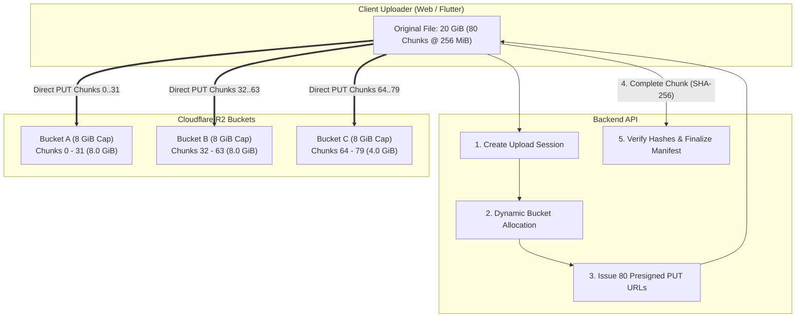
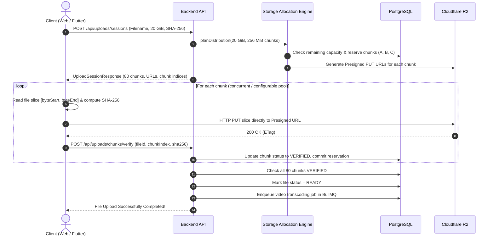

# Large File Upload Architecture: Distributed Chunking & Resumability

## 1. Problem Statement & Design Objectives
Modern high-fidelity media uploads (such as 4K HDR movies, long-form podcast recordings, and raw archival footage) range from 500 MB to 20 GB or more. Given our application-enforced **8 GB logical bucket quota**, files larger than 8 GB cannot fit into a single bucket.

The upload subsystem addresses this with:
1. **Zero Server Memory Bottlenecks**: High-bandwidth binary streams bypass the application server and upload directly from Flutter/Web clients to Cloudflare R2 using presigned URLs.
2. **Distributed Bucket Spilling**: An arbitrary-sized file is partitioned into deterministic chunks and distributed across multiple buckets and accounts.
3. **Resilience & Resumability**: Network drops or interruptions at 18 GB of a 20 GB upload only require retrying unverified chunks, not restarting the entire upload.
4. **Data Integrity**: Every chunk and whole file is validated with SHA-256 checksums before entering the processing pipeline.

---

## 2. Distributed Chunking Topology (20 GiB File Example)

---

## 3. Upload Lifecycle Sequence

---

## 4. Key Implementation Rules
- **Memory Bounding**: Chunk reads in the client are streamed directly into the upload request or read using bounded `Blob.slice()` / Dart `RandomAccessFile.setPositionSync()`.
- **Parallelism & Backpressure**: Clients enforce concurrency limits (default: 3 concurrent chunk uploads) with exponential backoff on HTTP 429 / 5xx errors.
- **Deduplication**: When resuming an interrupted session, the client queries `GET /api/uploads/sessions/:id/status` and only uploads chunks with status `PENDING` or `FAILED`.
